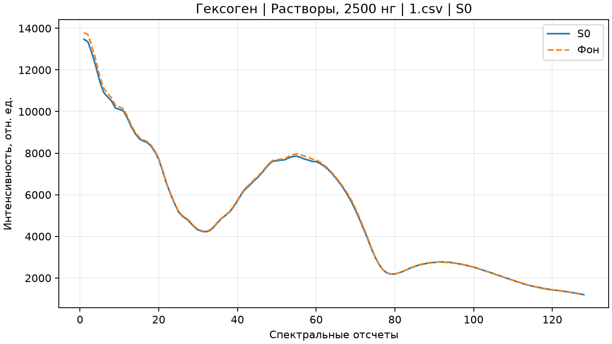
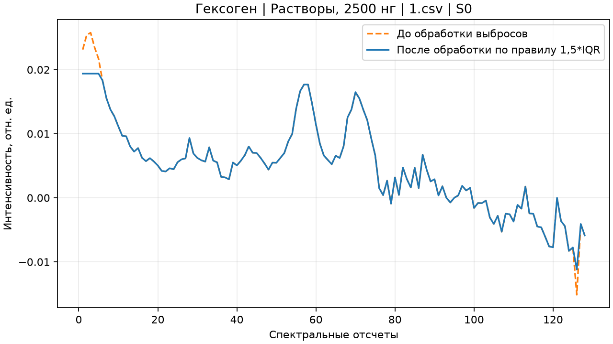
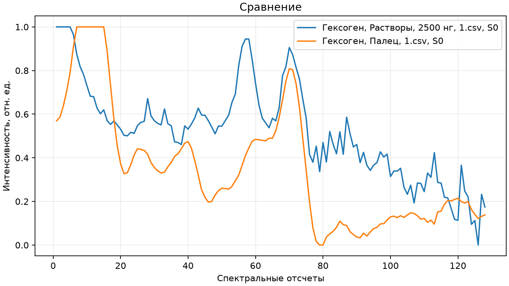

# Практическая работа 4

Была написана программа, которая выполнила преобразование данных и преобразовала их в датасет.

## Преобразования данных

Исходный сигнал раствора гексогена показан вместе с фоном.

Спектр раствора получен после коррекции фона.

Показан спектр до и после обработки выбросов.

Значения спектра приведены к диапазону от 0 до 1.

---

## Примеры

Показаны спектры гексогена в растворе и на пальце до нормировки.

Те же два спектра показаны после нормировки.
