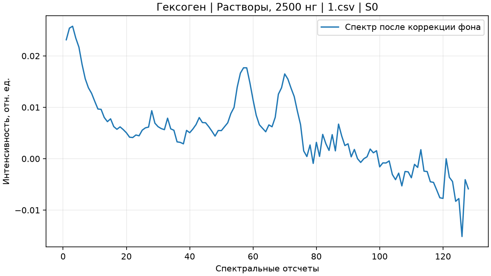
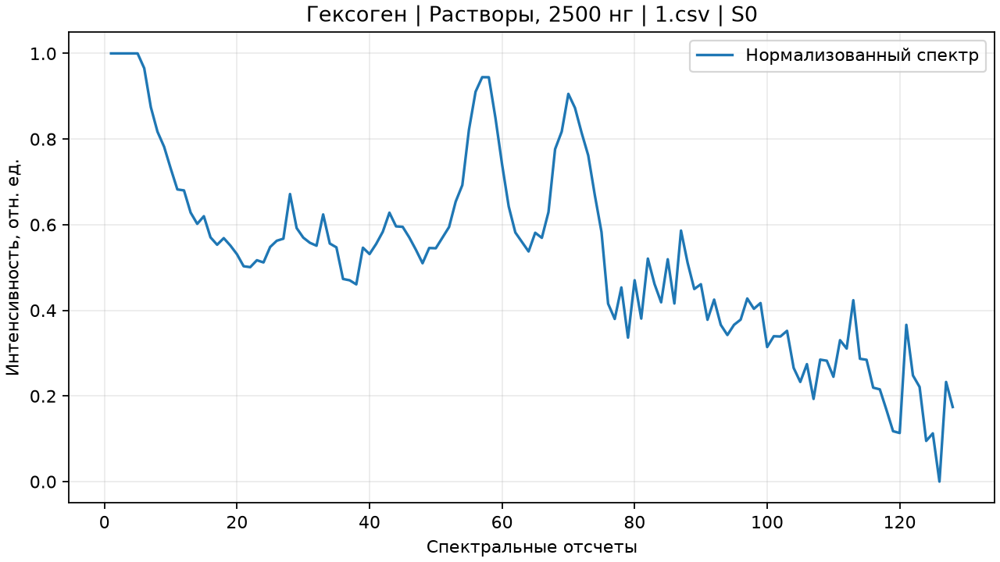
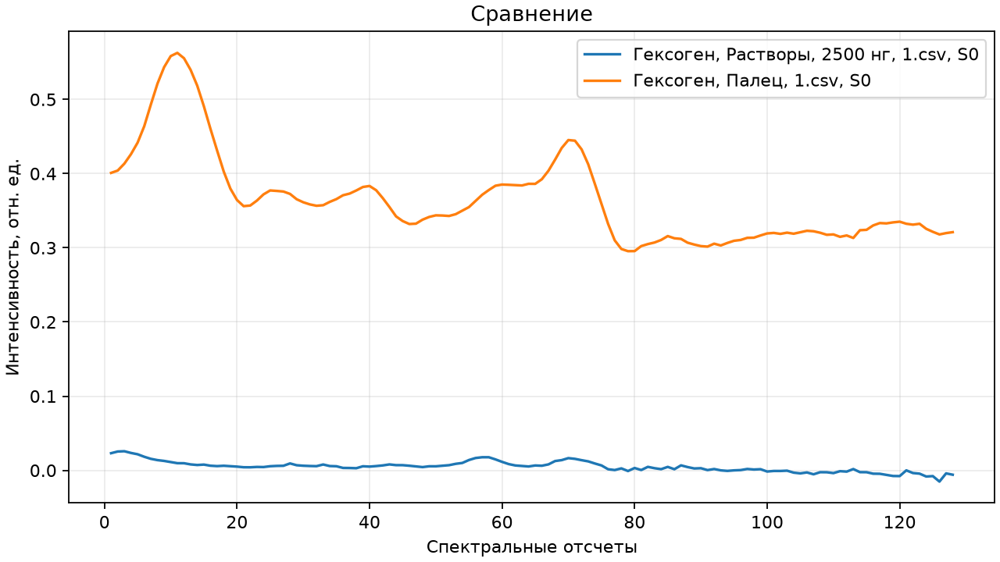

# Практическая работа 4. Подготовка спектральных данных

## Цель и результат

Цель работы состоит в подготовке спектральных измерений для машинного обучения по этапам методологии CRISP-DM. 
В рамках работы предстоит проанализировать 153 файла CSV создав датасет для обучения модели.

## 1. Загрузка и проверка данных

Файлы содержат измерения для гексогена, тротила и тэна. 
Из пути к файлу определены вещество, тип образца и указанная для раствора концентрация в нанограммах. 
Для образцов с пальца концентрация оставлена пустым.
В файлах содержится 1, 5 или 50 сигналов, каждый по 128 отсчётов. 
Фон также содержит 128 отсчётов. Все отсчеты являются целыми числами "uint"

| Данные после проверки | Размерность | Тип отсчётов | Пропуски | Нули | Отрицательные значения |
|-----------------------|------------:|--------------|---------:|-----:|-----------------------:|
| Исходные сигналы      |  726 на 128 | int          |        0 |    0 |                      0 |
| Фон                   |  152 на 128 | int          |        0 |    0 |                      0 |

Для пропусков выбрано исключение файлов, которые не удалось корректно разобрать. 
Это сохраняет соответствие между отсчётами сигнала и фона. 
Файл "Гексоген/Растворы/1500нг/1.csv" исключён из-за некорректного формата. 
В принятых данных пропусков нет.

## 2. Обработка спектров

### Коррекция фона

Для каждого отсчёта спектр рассчитан по формуле 1.

```
S[i] = (F[i] - S1[i]) / F[i]                       | (1)
```

Где:
* `S1` обозначает исследуемый сигнал;
* `F` обозначает фоновый сигнал. 

На рисунках 1 и 2 показан сигнал S0 раствора гексогена 2500 нг.


Рисунок 1. Исходный сигнал и фон.



Рисунок 2. Спектр после коррекции фона.

### Обработка выбросов

У каждого спектра были обработы выбросы по правилу 1,5 * IQR
На рисунке 3 показан спектр до и после обработки выбросов по IQR


Рисунок 3. Спектр до и после обработки выбросов.

### Нормировка

После обработки выбросов каждый спектр нормирован по формуле (2) 

```
x[i]' = (x[i] - x_min) / (x_max - x_min)           | (2)
```

Где:
* `x[i]'` - нормированное значение, лежащее в диапазоне от нуля до единицы;
* `x[i]` – значение измеренного спектра i-го отсчёта;
* `x_min, x_max` – минимальное и максимальное значение соответственно для измеренного спектра объекта (вещества).

На рисунке 4 представлен нормированный спектр раствора.



Рисунок 4. Нормированный спектр раствора.

В качестве сравнения представлены рисунки 4 и 5. 
На рисунке 4 изображены спектры гексогена в растворе и на пальце после коррекции фона.
На рисунке 5 изображены те же спектры после обработки выбросов и нормировки.



Рисунок 5. Спектры гексогена в растворе и на пальце после коррекции фона.


Рисунок 6. Спектры после обработки выбросов и нормировки.

## 3. Описательные статистики до и после обработки

Статистики из практической работы 3 рассчитаны по 128 отсчётам каждого сигнала и каждого итогового спектра. 
Для исходных данных также получена отдельная сводка по общему фону каждого файла.

В таблице приведён пример для сигнала S0 раствора гексогена 2500 нг из файла 1.csv. 

| Показатель                  |  Исходный сигнал | Обработанный спектр |
|-----------------------------|-----------------:|--------------------:|
| Среднее арифметическое      |     5 071,734375 |            0,523739 |
| Медиана                     |          4 669,5 |            0,543177 |
| Мода                        |            7 667 |                   1 |
| Размах                      |           12 271 |                   1 |
| Среднее линейное отклонение |     2 628,334473 |            0,167763 |
| Дисперсия                   | 9 470 680,632568 |            0,047471 |
| Стандартное отклонение      |     3 077,447097 |            0,217878 |
| Коэффициент вариации        |          60,68 % |             41,60 % |

## 4. Разбиение на выборки

Выбрана пропорция 80/20 по числу спектров. 
Обучающая выборка содержит основную часть данных, а тестовая предназначена для итоговой проверки на отдельных измерениях. 
Все спектры одного CSV направлены в одну выборку, поскольку у них общий фон.

| Вещество       | Обучающая выборка | Тестовая выборка | Всего |
|----------------|------------------:|-----------------:|------:|
| Гексоген       |               140 |               35 |   175 |
| Тротил         |               221 |               55 |   276 |
| Тэн            |               220 |               55 |   275 |
| Всего спектров |               581 |              145 |   726 |
| Доля спектров  |             80,0% |            20,0% |  100% |

В обучающую выборку вошли 120 исходных CSV, в тестовую вошли 32. 
В итоговом CSV каждая строка содержит 128 признаков от x_001 до x_128, метку класса и метаданные измерения.

## Вывод

Конвейер загружает исходные файлы, проверяет их, обрабатывает спектры и сохраняет две выборки. 
Из 153 исходных CSV после проверки использованы 152 файла. 
Получено 726 обработанных спектров по 128 отсчётов. 

Исходный код и команды для воспроизведения результатов доступны в репозитории проекта https://github.com/ifYouAlbert/task4-data-preprocess
